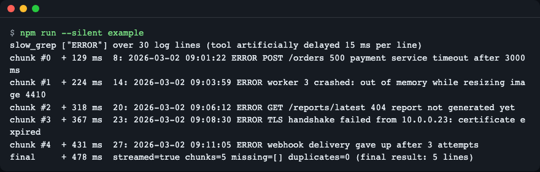
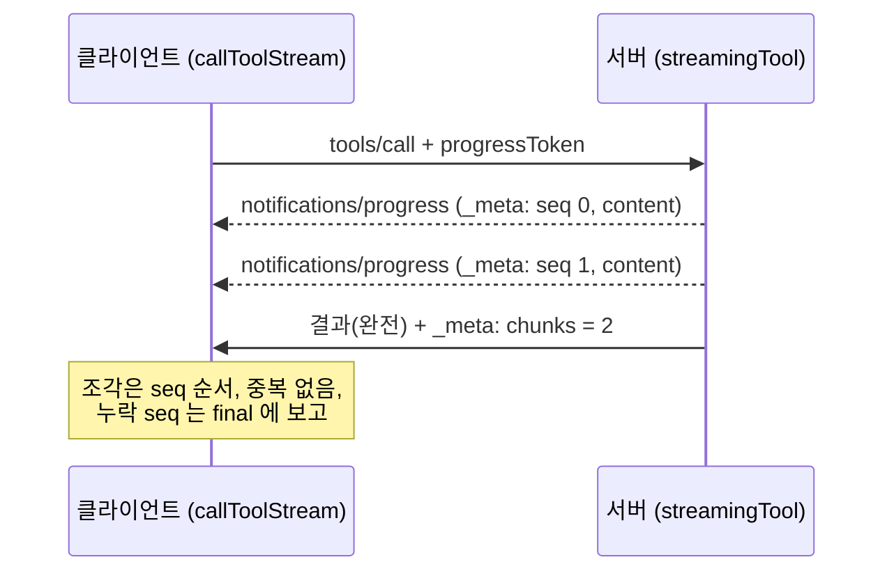
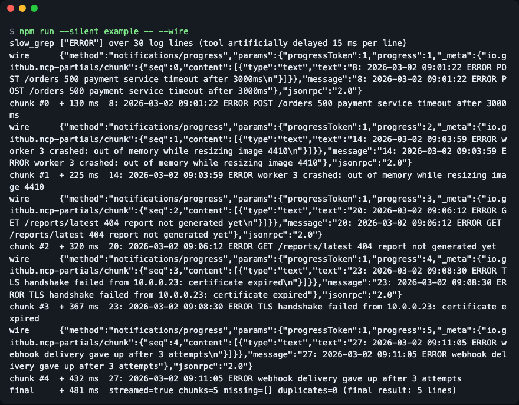
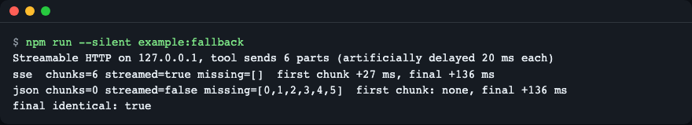
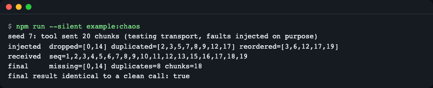

# mcp-partials

[English](README.md) | **한국어**

MCP 스펙에 이미 있는 진행 알림(progress notification) 위에, 순서가 맞고 중복이 없는 부분 결과(partial result)를 얹어 주는 라이브러리입니다. 도구 핸들러를 `async function*` 으로 바꾸고 `streamingTool()` 로 감싸면, 호출하는 쪽이 `callToolStream()` 으로 조각을 읽습니다. 공식 TypeScript SDK v1·v2 에서 동작하고, 조각을 전달할 수 없는 경로에서도 호출자는 완전한 최종 결과를 받습니다. 런타임 의존성은 0개입니다.



*`npm run example`: 조각 다섯 개가 +130 ms ~ +433 ms 에 도착하고, 최종 결과는 +482 ms 에 나옵니다. 타이밍을 볼 수 있게 도구를 일부러 늦췄습니다(로그 한 줄당 15 ms).*

## 설치

```bash
# SDK v1
npm install mcp-partials @modelcontextprotocol/sdk zod
# SDK v2
npm install mcp-partials @modelcontextprotocol/server @modelcontextprotocol/client zod
```

Node 20 이상이 필요하고 런타임 의존성은 없습니다. 공식 SDK 는 선택적 peer 의존성이라 이미 쓰는 쪽을 그대로 씁니다: `@modelcontextprotocol/sdk`(v1, 1.32.2 로 확인) 또는 `@modelcontextprotocol/server` + `@modelcontextprotocol/client`(v2, 2.4.0 으로 확인).

clone 해서 예제를 돌리려면: `git clone https://github.com/LeeGyeongPil/mcp-partials && cd mcp-partials && npm install`.

## 빠르게 시작하기

조각 세 개를 내보내는 서버 도구와 그것을 읽는 클라이언트입니다. SDK 의 인메모리 전송으로 한 프로세스 안에서 돌아가므로 네트워크도 API 키도 필요 없습니다. `quick.mjs` 로 저장하거나(또는 package.json 에 `"type": "module"` 설정) `node quick.mjs` 로 실행하세요.

```js
import { z } from 'zod';
import { McpServer } from '@modelcontextprotocol/sdk/server/mcp.js';
import { Client } from '@modelcontextprotocol/sdk/client/index.js';
import { InMemoryTransport } from '@modelcontextprotocol/sdk/inMemory.js';
import { callToolStream, partialsCapability, streamingTool } from 'mcp-partials';

const server = new McpServer({ name: 'demo', version: '1.0.0' }, { capabilities: partialsCapability() });
server.registerTool('count', { inputSchema: { to: z.number() } },
  streamingTool(async function* ({ to }) { for (let i = 1; i <= to; i++) yield `step ${i}\n`; }));

const [c, s] = InMemoryTransport.createLinkedPair();
await server.connect(s);
const client = new Client({ name: 'cli', version: '1.0.0' });
await client.connect(c);

for await (const ev of callToolStream(client, { name: 'count', arguments: { to: 3 } })) {
  if (ev.type === 'chunk') console.log('chunk', ev.seq, JSON.stringify(ev.content[0].text));
  else console.log('final', ev.streamed, ev.chunks, ev.missing, ev.duplicates);
}
await client.close();
```

```text
chunk 0 "step 1\n"
chunk 1 "step 2\n"
chunk 2 "step 3\n"
final true 3 [] 0
```

마지막 줄이 `final` 이벤트입니다: `streamed=true`, 조각 3개, 누락 없음, 중복 없음. SDK v2 에서도 도구 코드는 같고 import 만 바뀝니다: `McpServer`·`InMemoryTransport` 는 `@modelcontextprotocol/server`, `Client` 는 `@modelcontextprotocol/client` 에서 가져옵니다(`examples/chaos.ts` 참고).

## 전/후 비교

기존 도구에서 바뀌는 것은 핸들러 모양과 감싸기 호출 하나입니다.

```js
// Before: 호출자는 전부 끝날 때까지 기다린다
server.registerTool('slow_grep', { inputSchema: { words: z.array(z.string()) } },
  async ({ words }) => {
    const hits = [];
    for (const line of lines) if (words.some((w) => line.includes(w))) hits.push(line);
    return { content: [{ type: 'text', text: hits.join('\n') }] };
  });

// After: 찾는 즉시 조각으로 보내고, 최종 결과는 그대로 완전하다
server.registerTool('slow_grep', { inputSchema: { words: z.array(z.string()) } },
  streamingTool(async function* ({ words }) {
    for (const line of lines) if (words.some((w) => line.includes(w))) yield line + '\n';
  }));
```

`new McpServer(...)` 에 `{ capabilities: partialsCapability() }` 를 넘기는 것을 잊지 마세요(빠르게 시작하기 참고).

## 핵심 개념



1. **조각은 스펙의 진행 알림에 실립니다.** `yield` 마다 `notifications/progress` 가 하나 나가고, `params._meta["io.github.mcp-partials/chunk"]` 에 `{ seq, content }` 가 들어 있습니다. 새 메서드도, 비표준 최상위 필드도 없습니다. `progress` 는 스펙대로 알림마다 1씩 오르는 별도 카운터입니다.
2. **최종 결과가 권위입니다.** 도구의 `CallToolResult` 는 항상 완전합니다(조각을 합친 것, 또는 생성기가 반환한 값). 그리고 `_meta["io.github.mcp-partials/final"] = { chunks }` 를 달고 갑니다. 조각은 미리보기일 뿐 유일한 사본이 아닙니다.
3. **순서와 중복은 클라이언트에서 바로잡습니다.** `callToolStream()` 은 작은 창(`reorderWindow`, 기본 16) 안에서 조각을 재정렬하고, 중복을 버리고, 받은 개수와 `chunks` 를 비교해 끝쪽에서 사라진 것까지 `missing` 으로 알려 줍니다.
4. **하위 호환입니다.** `onprogress` 를 넘기지 않는 클라이언트는 알림 없이 전체 결과만 받습니다. `enableJsonResponse: true` 인 Streamable HTTP 에는 스트림이 없으므로 `callToolStream()` 은 조각 0개, `final.streamed` 는 `false`, 최종 결과는 같습니다.

## API

주 진입점: `mcp-partials`.

| 이름 | 하는 일 | 주요 인자 | 반환 |
|---|---|---|---|
| `streamingTool(gen, opts?)` | async generator 를 SDK v1·v2 의 `registerTool` 핸들러로 감쌈 | `gen(args, ctx)`; `opts`: `coalesceMs`, `total`, `message`, `codec`, `sdk` | 도구 핸들러 |
| `callToolStream(client, params, opts?)` | 도구를 호출해 조각을 스트리밍하고 마지막에 final 이벤트 하나를 냄 | `params`: `{ name, arguments? }`; `opts`: `signal`, `timeoutMs`, `maxTotalTimeoutMs`, `resetTimeoutOnProgress`, `reorderWindow`, `sdk`, `codec` | `ToolStream` (이벤트 `AsyncIterable` + `result()`) |
| `collectToolStream(client, params, opts?)` | 스트림 전체를 돌리고 조각을 합침 | `callToolStream` 과 같음 | final 이벤트 + `content`, `matchesFinal`(조각이 하나도 없으면 `null`) |
| `partialsCapability()` | `new McpServer(info, { capabilities })` 에 넘길 capability 객체 | 없음 | `{ experimental: {...} }` |
| `serverSupportsPartials(client)` | 연결된 서버가 capability 를 알렸는지(`connect` 뒤에 호출) | client | `boolean` |
| `streamingToolMeta()` | 도구 정의에 붙일 수 있는 `_meta` 표식 | 없음 | 객체 |
| `ChunkAssembler` | SDK 없이 쓰는 재정렬·중복 제거·누락 판단 로직 | `new ChunkAssembler({ window? })`, `push(seq, content)`, `finish(expected?)`, `duplicates`, `late` | 이벤트 / `{ flushed, missing }` |
| `metaCodec`, `ChunkCodec` | 조각이 알림 안 어디에 있는지(기본 `_meta`) | `encode`, `decode` | 코덱 |
| `mergeContent`, `toContentBlocks` | 도우미: 인접한 텍스트 블록 병합 / 문자열·블록을 블록 배열로 | 블록 / `ChunkInput` | `ContentBlock[]` |
| `detectClientSdk(client)` | 객체 모양으로 v1·v2 구분 | client | `'v1' \| 'v2'` |
| `PartialsError` | `code` 가 있는 오류: `'UNSUPPORTED_SDK'`, `'BAD_CHUNK'`, `'ABORTED'` | | |
| 상수 | `PARTIALS_META_KEY`, `PARTIALS_FINAL_KEY`, `PARTIALS_CAPABILITY_KEY`, `PARTIALS_VERSION`, `MAX_SEQ_JUMP` | | |

생성기의 컨텍스트(`ctx`): `signal`(호출자가 취소하면 abort 됨, `fetch`·`sleep` 에 넘기세요), `streaming`(호출자가 진행 알림을 요청했으면 true), `raw`(SDK 가 넘긴 원래 핸들러 인자).

`callToolStream` 이벤트: `{ type: 'chunk', seq, content }` 여러 개와 `{ type: 'final', result, streamed, chunks, missing, duplicates }` 하나. `ToolStream` 은 소비자 하나용이며 한 번만 반복할 수 있습니다.

테스트용 진입점: `mcp-partials/testing`.

| 이름 | 하는 일 | 주요 인자 | 반환 |
|---|---|---|---|
| `withChaos(transport, opts)` | 내보내는 진행 알림을 실제로 복제·누락·순서 바꿈 하는 전송 래퍼(시드 고정, 재현 가능) | `seed`, `duplicate`, `drop`, `reorder`(0~1), `only: 'progress'` | 전송 + `stats()` |
| `mulberry32(seed)` | `withChaos` 가 쓰는 작은 시드 난수 생성기 | seed | `() => number` |

## 사용 예

각 예제는 [`examples/`](examples) 의 실행 가능한 파일입니다. 샘플 데이터는 지어낸 작은 로그입니다.

**1. 실행 중에 결과가 먼저 보이는 느린 도구** (`examples/slow-grep.ts`)

```bash
npm run --silent example
```

```text
slow_grep ["ERROR"] over 30 log lines (tool artificially delayed 15 ms per line)
chunk #0  + 130 ms  8: 2026-03-02 09:01:22 ERROR POST /orders 500 payment service timeout after 3000ms
chunk #1  + 224 ms  14: 2026-03-02 09:03:59 ERROR worker 3 crashed: out of memory while resizing image 4410
chunk #2  + 322 ms  20: 2026-03-02 09:06:12 ERROR GET /reports/latest 404 report not generated yet
chunk #3  + 369 ms  23: 2026-03-02 09:08:30 ERROR TLS handshake failed from 10.0.0.23: certificate expired
chunk #4  + 433 ms  27: 2026-03-02 09:11:05 ERROR webhook delivery gave up after 3 attempts
final     + 482 ms  streamed=true chunks=5 missing=[] duplicates=0 (final result: 5 lines)
```

`-- --wire` 를 붙이면 원문 JSON-RPC 알림도 같이 찍혀서, 조각 하나가 어떤 스펙 메시지가 되는지 볼 수 있습니다.



*`--wire`: 조각마다 `progress` 가 커지는 스펙 `notifications/progress` 이고, 조각은 `_meta` 에 들어 있습니다.*

**2. 조각을 전달할 수 없을 때** (`examples/fallback-http.ts`)

```bash
npm run --silent example:fallback
```

```text
Streamable HTTP on 127.0.0.1, tool sends 6 parts (artificially delayed 20 ms each)
sse  chunks=6 streamed=true missing=[]  first chunk +26 ms, final +132 ms
json chunks=0 streamed=false missing=[0,1,2,3,4,5]  first chunk: none, final +130 ms
final identical: true
```

JSON 응답에서는 조각이 하나도 전달되지 않지만 최종 결과는 같고, `missing` 은 도구가 보냈지만 받지 못한 조각 여섯 개를 솔직하게 알려 줍니다.



*`example:fallback`: 같은 도구, 전송 방식 두 가지, 같은 최종 결과.*

**3. 일부러 불안정한 경로** (`examples/chaos.ts`, SDK v2 사용)

```bash
npm run --silent example:chaos
```

```text
seed 7: tool sent 20 chunks (testing transport, faults injected on purpose)
injected  dropped=[0,14] duplicated=[2,3,5,7,8,9,12,17] reordered=[3,6,12,17,19]
received  seq=1,2,3,4,5,6,7,8,9,10,11,12,13,15,16,17,18,19
final     missing=[0,14] duplicates=8 chunks=18
final result identical to a clean call: true
```

`withChaos` 는 알림을 실제로 누락·복제·교환합니다. 그래도 조각은 오름차순·중복 없이 도착하고, 사라진 둘은 보고되며, 최종 결과는 깨끗한 호출과 같습니다. 직접 만든 테스트에서 써 보세요.



*`example:chaos`: 일부러 넣은 결함(시드 7)과 그래도 클라이언트가 보고하는 결과.*

**취소.** `for await` 루프를 `break` 하거나 넘겨 준 `signal` 을 abort 하면 SDK 를 통해 `notifications/cancelled` 가 나가고, 서버 생성기의 `finally` 블록이 실행됩니다. `break` 는 조용히 끝나고, abort 는 `PartialsError`(code `'ABORTED'`)로 거부됩니다.

**작은 조각 묶기.** `streamingTool(gen, { coalesceMs: 50 })` 은 50 ms 안에 나온 조각을 알림 하나로 합칩니다. 10 ms 마다 yield 하는 도구도 알림은 50 ms 에 한 번꼴입니다. 합친 텍스트와 최종 결과는 그대로입니다.

## 설정

| 옵션 | 위치 | 기본값 | 뜻 |
|---|---|---|---|
| `coalesceMs` | `streamingTool` | `0` | 이 시간(ms) 안에 나온 조각을 알림 하나로 묶음 |
| `total` | `streamingTool` | 없음 | 스펙 `total` 필드 값 |
| `message` | `streamingTool` | 조각 텍스트, 200자 | 스펙 `message` 필드에 넣을 문구 |
| `codec` | 양쪽 | `metaCodec` | 조각이 알림 안 어디에 있는지(양쪽이 같아야 함) |
| `sdk` | 양쪽 | `'auto'` | 자동 판별이 안 될 때 `'v1'`·`'v2'` 를 강제 |
| `timeoutMs`, `maxTotalTimeoutMs` | `callToolStream` | SDK 기본값 | 요청 타임아웃과 전체 타임아웃 |
| `resetTimeoutOnProgress` | `callToolStream` | `true` | 조각이 오면 요청 타임아웃을 다시 시작 |
| `reorderWindow` | `callToolStream` | `16` | 빈 seq 를 누락으로 포기하기 전에 얼마나 앞선 조각까지 기다릴지 |
| `signal` | `callToolStream` | 없음 | 호출 취소 |

## 언제 쓰나

- 이럴 때: 몇 초~몇 분 걸리고 결과가 조금씩 나오는 도구(검색, 빌드 출력, 긴 파일 훑기)에서, 호출자가 결과를 오는 대로 읽되 최종 결과는 완전해야 할 때. 알림이 복제·누락·재정렬되는 경우를 자기 테스트에서 재현하고 싶을 때도 맞습니다.
- 이 라이브러리가 바꾸는 것은 도구 결과 경로뿐입니다. 최종 결과는 항상 완전하므로 조각을 무시하는 호출자도 잃는 것이 없습니다.
- 특정 호스트(에디터, 데스크톱 앱, 인스펙터)가 진행 `message` 나 조각을 사용자에게 보여 줄지는 그 호스트에 달려 있습니다. 이 프로젝트는 어떤 호스트도 확인하지 않았습니다.
- 맞지 않을 때: 진행 막대만 필요하다면 SDK 의 기본 `onprogress` 로 충분합니다. 이미 FastMCP 로 서버를 만들고 그 스트리밍에 만족한다면 그대로 쓰세요.

## 대안과 비교

2026-11-18 확인. 내용은 바뀔 수 있으니 링크한 페이지에서 다시 확인하세요.

| 선택지 | 하는 일 | 이 라이브러리와 다른 점 |
|---|---|---|
| [FastMCP](https://github.com/punkpeye/fastmcp) `streamContent`(TypeScript, 확인 당시 4.28.0) | FastMCP 프레임워크 안에서 자체 알림 메서드로 도구 내용을 스트리밍 | 그 프레임워크가 필요합니다. `mcp-partials` 는 공식 `McpServer` 에 붙고 스펙의 `notifications/progress` 를 보내며, 조각마다 요청의 진행 토큰에 묶인 순번이 있습니다 |
| 공식 SDK `onprogress` 그대로 쓰기 | 알림마다 진행 숫자와 선택적 메시지 | 조각 형식·순번·중복 제거·async iterator 가 없습니다. 직접 만들거나 이 라이브러리를 쓰면 됩니다 |
| 표준화 시도: [typescript-sdk PR #2015](https://github.com/modelcontextprotocol/typescript-sdk/pull/2015)(task partials, 2026-10-07 병합 없이 닫힘), [python-sdk PR #669](https://github.com/modelcontextprotocol/python-sdk/pull/669)(닫힘), [스펙 이슈 #2932](https://github.com/modelcontextprotocol/modelcontextprotocol/issues/2932)(SEP-2998 은 Tasks/Events 워킹그룹으로 이관) | 도구 부분 결과를 스펙에 넣자는 제안 | 아직 표준이 아닙니다. 이 라이브러리는 현재 스펙 안에 머무는 임시 대안입니다 |

## 한계

- **실험적.** 조각 형식(`_meta["io.github.mcp-partials/chunk"]`)은 이 라이브러리 자체 규약이지 MCP 표준이 아닙니다. [#2932](https://github.com/modelcontextprotocol/modelcontextprotocol/issues/2932) 의 스펙 논의는 정해지지 않았습니다(2026-11-18 확인). 표준 필드가 생기면 `ChunkCodec` 을 바꿔 맞춥니다. 0.x 동안은 변경을 예상하세요.
- 내용 블록만 스트리밍합니다. `structuredContent` 는 최종 결과에만 들어갑니다.
- 끊긴 SSE 스트림은 재개하지 않습니다(`Last-Event-ID`). 최종 결과와 `missing` 이 복구 수단입니다.
- 생성기가 `ctx.signal` 을 무시하면 취소 뒤 `finally` 블록이 현재 `await` 가 끝난 다음에야 늦게 실행됩니다.
- `reorderWindow` 가 포기한 뒤에 도착한 조각은 `missing` 에 남습니다.
- `ToolStream` 은 소비자가 한 명입니다. 읽지 않은 이벤트는 메모리에 쌓입니다.
- 어떤 호스트가 진행 메시지나 조각을 사용자에게 보여 주는지는 이 프로젝트가 확인하지 않았습니다.

## 문제 해결

| 증상 | 원인 | 해결 |
|---|---|---|
| `final.streamed` 가 `false` 이고 `chunks` 가 0 | 전송에 스트림이 없음(`enableJsonResponse: true` 인 Streamable HTTP), 서버가 `streamingTool` 을 쓰지 않음, 또는 호출자 SDK 가 진행 토큰을 넘기지 않음 | SSE 모드를 쓰거나 최종 결과에 의존하세요. `final.missing` 은 도구가 보낸 조각 수를 여전히 알려 줍니다 |
| `PartialsError` code `UNSUPPORTED_SDK` | 클라이언트나 핸들러 객체가 SDK v1 도 v2 도 아닌 모양(예: 직접 만든 래퍼) | `sdk: 'v1'` 또는 `sdk: 'v2'` 를 넘기세요 |
| 감싼 도구인데 조각이 안 옴 | 호출자가 `onprogress` 없이 `client.callTool()` 을 씀 | `callToolStream()` 으로 호출하세요 |
| 취소 뒤 생성기 정리가 느림 | 생성기가 `ctx.signal` 을 무시하는 작업을 기다리는 중 | `fetch`·`sleep`·자식 프로세스에 `ctx.signal` 을 넘기세요 |
| 정상 회선인데 `missing` 이 비어 있지 않음 | 조각이 `reorderWindow` 가 허용하는 것보다 늦게 도착 | `reorderWindow` 를 키우세요 |

## 버전·호환성

- [SemVer](https://semver.org/lang/ko/)를 따릅니다. 0.x 동안은 마이너 버전에서 API 가 바뀔 수 있고, 바뀌면 [CHANGELOG.md](CHANGELOG.md)에 적습니다.
- `@modelcontextprotocol/sdk` 1.32.2 와 `@modelcontextprotocol/server`·`client` 2.4.0 으로, Node v26.13.0 에서 확인했습니다(이 레포의 CI 워크플로는 Node 20·22·24 를 대상으로 합니다).

## 개발·기여

```bash
npm install
npm test               # 빌드 후 실제 SDK v1·v2 를 상대로 테스트 33개 실행
npm run build
```

## 라이선스

MIT.
