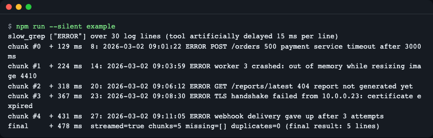
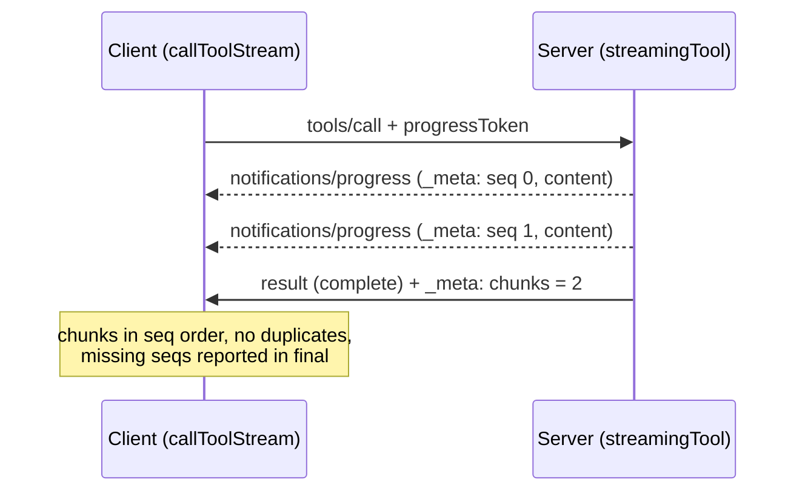
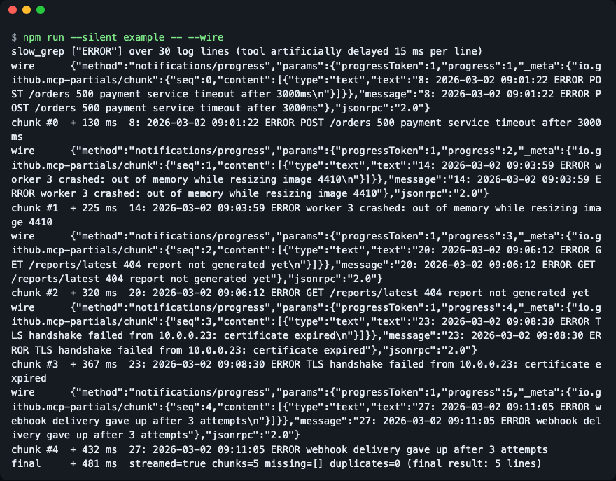
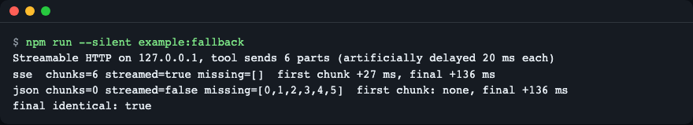
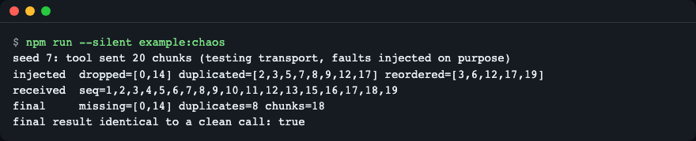

# mcp-partials

**English** | [한국어](README.ko.md)

Ordered, de-duplicated partial results for MCP tools, built on the progress notifications the MCP spec already defines. You turn a tool handler into an `async function*`, wrap it with `streamingTool()`, and callers read the chunks with `callToolStream()`. It works with the official TypeScript SDK v1 and v2, and when chunks cannot be delivered the caller still gets the complete final result. Zero runtime dependencies.



*`npm run example`: five chunks arrive at +130 ms … +433 ms, before the final result at +482 ms. The tool is artificially delayed (15 ms per log line) so you can see the timing.*

## Install

```bash
# SDK v1
npm install mcp-partials @modelcontextprotocol/sdk zod
# SDK v2
npm install mcp-partials @modelcontextprotocol/server @modelcontextprotocol/client zod
```

Requires Node 20 or newer. There are no runtime dependencies. The official SDK is an optional peer dependency, and you bring the one you already use: `@modelcontextprotocol/sdk` (v1, tested with 1.32.2) or `@modelcontextprotocol/server` + `@modelcontextprotocol/client` (v2, tested with 2.4.0).

To run the examples from a clone: `git clone https://github.com/LeeGyeongPil/mcp-partials && cd mcp-partials && npm install`.

## Quick start

A server tool that yields three chunks, and a client that reads them. Everything runs in one process over the SDK's in-memory transport, so no network or API key is needed. Save it as `quick.mjs` (or set `"type": "module"` in package.json) and run `node quick.mjs`.

```js
import { z } from 'zod';
import { McpServer } from '@modelcontextprotocol/sdk/server/mcp.js';
import { Client } from '@modelcontextprotocol/sdk/client/index.js';
import { InMemoryTransport } from '@modelcontextprotocol/sdk/inMemory.js';
import { callToolStream, partialsCapability, streamingTool } from 'mcp-partials';

const server = new McpServer({ name: 'demo', version: '1.0.0' }, { capabilities: partialsCapability() });
server.registerTool('count', { inputSchema: { to: z.number() } },
  streamingTool(async function* ({ to }) { for (let i = 1; i <= to; i++) yield `step ${i}\n`; }));

const [c, s] = InMemoryTransport.createLinkedPair();
await server.connect(s);
const client = new Client({ name: 'cli', version: '1.0.0' });
await client.connect(c);

for await (const ev of callToolStream(client, { name: 'count', arguments: { to: 3 } })) {
  if (ev.type === 'chunk') console.log('chunk', ev.seq, JSON.stringify(ev.content[0].text));
  else console.log('final', ev.streamed, ev.chunks, ev.missing, ev.duplicates);
}
await client.close();
```

```text
chunk 0 "step 1\n"
chunk 1 "step 2\n"
chunk 2 "step 3\n"
final true 3 [] 0
```

The last line is the `final` event: `streamed=true`, 3 chunks, nothing missing, no duplicates. With SDK v2 the tool code is the same; only the imports change: `McpServer` and `InMemoryTransport` come from `@modelcontextprotocol/server`, `Client` from `@modelcontextprotocol/client` (see `examples/chaos.ts`).

## Before / after

The change to an existing tool is the handler shape plus one wrapper call.

```js
// Before: the caller waits for everything
server.registerTool('slow_grep', { inputSchema: { words: z.array(z.string()) } },
  async ({ words }) => {
    const hits = [];
    for (const line of lines) if (words.some((w) => line.includes(w))) hits.push(line);
    return { content: [{ type: 'text', text: hits.join('\n') }] };
  });

// After: each hit is sent as soon as it is found, the final result is still complete
server.registerTool('slow_grep', { inputSchema: { words: z.array(z.string()) } },
  streamingTool(async function* ({ words }) {
    for (const line of lines) if (words.some((w) => line.includes(w))) yield line + '\n';
  }));
```

Remember to pass `{ capabilities: partialsCapability() }` to `new McpServer(...)` (see Quick start).

## Core concepts



1. **Chunks ride on spec progress notifications.** Each `yield` becomes a `notifications/progress` whose `params._meta["io.github.mcp-partials/chunk"]` holds `{ seq, content }`. No new method and no non-standard top-level field. `progress` is a separate counter that increases by one per notification, as the spec requires.
2. **The final result is authoritative.** The tool's `CallToolResult` is always complete (the merged chunks, or whatever the generator returns) and carries `_meta["io.github.mcp-partials/final"] = { chunks }`. Chunks are a preview, never the only copy.
3. **Order and duplicates are fixed on the client.** `callToolStream()` re-orders chunks inside a small window (`reorderWindow`, default 16), drops duplicates, and compares the received count with `chunks` to report `missing` seqs, including ones lost at the end.
4. **Backward compatible.** A client that does not pass `onprogress` gets no notifications and the full result. Over Streamable HTTP with `enableJsonResponse: true` there is no stream, so `callToolStream()` yields zero chunks, `final.streamed` is `false`, and the final result is the same.

## API

Main entry: `mcp-partials`.

| Name | What it does | Main arguments | Returns |
|---|---|---|---|
| `streamingTool(gen, opts?)` | Wraps an async generator as a `registerTool` handler for SDK v1 or v2 | `gen(args, ctx)`; `opts`: `coalesceMs`, `total`, `message`, `codec`, `sdk` | tool handler |
| `callToolStream(client, params, opts?)` | Calls a tool and streams its chunks, then one final event | `params`: `{ name, arguments? }`; `opts`: `signal`, `timeoutMs`, `maxTotalTimeoutMs`, `resetTimeoutOnProgress`, `reorderWindow`, `sdk`, `codec` | `ToolStream` (`AsyncIterable` of events + `result()`) |
| `collectToolStream(client, params, opts?)` | Runs a whole stream and merges the chunks | same as `callToolStream` | final event plus `content` and `matchesFinal` (`null` when no chunk arrived) |
| `partialsCapability()` | Capability object to pass to `new McpServer(info, { capabilities })` | none | `{ experimental: {...} }` |
| `serverSupportsPartials(client)` | True if the connected server advertised the capability (call after `connect`) | client | `boolean` |
| `streamingToolMeta()` | `_meta` marker you can put on a tool definition | none | object |
| `ChunkAssembler` | The reorder / de-duplicate / missing logic with no SDK involved | `new ChunkAssembler({ window? })`, `push(seq, content)`, `finish(expected?)`, `duplicates`, `late` | events / `{ flushed, missing }` |
| `metaCodec`, `ChunkCodec` | Where chunks live inside a notification (default: `_meta`) | `encode`, `decode` | codec |
| `mergeContent`, `toContentBlocks` | Helpers: merge adjacent text blocks; turn a string/block into blocks | blocks / `ChunkInput` | `ContentBlock[]` |
| `detectClientSdk(client)` | Tells v1 from v2 by object shape | client | `'v1' \| 'v2'` |
| `PartialsError` | Error with `code`: `'UNSUPPORTED_SDK'`, `'BAD_CHUNK'`, `'ABORTED'` | | |
| constants | `PARTIALS_META_KEY`, `PARTIALS_FINAL_KEY`, `PARTIALS_CAPABILITY_KEY`, `PARTIALS_VERSION`, `MAX_SEQ_JUMP` | | |

Generator context (`ctx`): `signal` (aborted when the caller cancels; pass it to `fetch` or `sleep`), `streaming` (true when the caller asked for progress), `raw` (the original SDK handler argument).

Events from `callToolStream`: `{ type: 'chunk', seq, content }` and one `{ type: 'final', result, streamed, chunks, missing, duplicates }`. A `ToolStream` is for one consumer and can be iterated once.

Testing entry: `mcp-partials/testing`.

| Name | What it does | Main arguments | Returns |
|---|---|---|---|
| `withChaos(transport, opts)` | Wraps a transport so outgoing progress notifications are really duplicated, dropped and swapped (seeded, repeatable) | `seed`, `duplicate`, `drop`, `reorder` (0 to 1), `only: 'progress'` | the transport plus `stats()` |
| `mulberry32(seed)` | The small seeded random generator used by `withChaos` | seed | `() => number` |

## Usage examples

Each example is a runnable file in [`examples/`](examples). The sample data is a small made-up log.

**1. A slow tool whose results show up while it runs** (`examples/slow-grep.ts`)

```bash
npm run --silent example
```

```text
slow_grep ["ERROR"] over 30 log lines (tool artificially delayed 15 ms per line)
chunk #0  + 130 ms  8: 2026-03-02 09:01:22 ERROR POST /orders 500 payment service timeout after 3000ms
chunk #1  + 224 ms  14: 2026-03-02 09:03:59 ERROR worker 3 crashed: out of memory while resizing image 4410
chunk #2  + 322 ms  20: 2026-03-02 09:06:12 ERROR GET /reports/latest 404 report not generated yet
chunk #3  + 369 ms  23: 2026-03-02 09:08:30 ERROR TLS handshake failed from 10.0.0.23: certificate expired
chunk #4  + 433 ms  27: 2026-03-02 09:11:05 ERROR webhook delivery gave up after 3 attempts
final     + 482 ms  streamed=true chunks=5 missing=[] duplicates=0 (final result: 5 lines)
```

Add `-- --wire` to also print the raw JSON-RPC notifications, so you can see the spec message each chunk becomes.



*`--wire`: each chunk is a spec `notifications/progress` with a growing `progress` and the chunk in `_meta`.*

**2. When chunks cannot be delivered** (`examples/fallback-http.ts`)

```bash
npm run --silent example:fallback
```

```text
Streamable HTTP on 127.0.0.1, tool sends 6 parts (artificially delayed 20 ms each)
sse  chunks=6 streamed=true missing=[]  first chunk +26 ms, final +132 ms
json chunks=0 streamed=false missing=[0,1,2,3,4,5]  first chunk: none, final +130 ms
final identical: true
```

With a JSON response, no chunk is delivered, yet the final result is identical and `missing` honestly lists the six chunks the tool sent but you did not receive.



*`example:fallback`: same tool, two transport modes, identical final result.*

**3. An unreliable path, on purpose** (`examples/chaos.ts`, uses SDK v2)

```bash
npm run --silent example:chaos
```

```text
seed 7: tool sent 20 chunks (testing transport, faults injected on purpose)
injected  dropped=[0,14] duplicated=[2,3,5,7,8,9,12,17] reordered=[3,6,12,17,19]
received  seq=1,2,3,4,5,6,7,8,9,10,11,12,13,15,16,17,18,19
final     missing=[0,14] duplicates=8 chunks=18
final result identical to a clean call: true
```

`withChaos` really drops, duplicates and swaps notifications. Chunks still arrive ascending and unique, the two dropped ones are reported, and the final result matches a clean call. Use it in your own tests.



*`example:chaos`: faults injected on purpose (seed 7), and what the client still reports.*

**Cancelling.** Breaking out of the `for await` loop, or aborting the `signal` you pass in, sends `notifications/cancelled` through the SDK. The server generator's `finally` block then runs. A `break` ends quietly; an abort rejects with `PartialsError` code `'ABORTED'`.

**Batching tiny chunks.** `streamingTool(gen, { coalesceMs: 50 })` merges chunks yielded within 50 ms into one notification, so a tool that yields every 10 ms sends at most about one notification per 50 ms. The merged text and the final result stay the same.

## Configuration

| Option | Where | Default | Meaning |
|---|---|---|---|
| `coalesceMs` | `streamingTool` | `0` | Batch chunks yielded within this many ms into one notification |
| `total` | `streamingTool` | none | Value for the spec `total` field |
| `message` | `streamingTool` | chunk text, 200 chars | Text for the spec `message` field |
| `codec` | both | `metaCodec` | Where chunks live inside the notification (use the same on both sides) |
| `sdk` | both | `'auto'` | Force `'v1'` or `'v2'` when auto-detection cannot decide |
| `timeoutMs`, `maxTotalTimeoutMs` | `callToolStream` | SDK defaults | Request timeout and overall timeout |
| `resetTimeoutOnProgress` | `callToolStream` | `true` | A chunk resets the per-request timeout |
| `reorderWindow` | `callToolStream` | `16` | How far ahead of a gap to wait before giving that seq up as missing |
| `signal` | `callToolStream` | none | Abort the call |

## When to use it

- Good fit: a tool that takes seconds or minutes and produces results incrementally (search, build output, long file scans), and you want callers to read them as they come while the final result stays complete. Also good when you want your own tests to cover duplicated, dropped or reordered notifications.
- This library only changes the tool result path. The final result is always complete, so a caller that ignores chunks loses nothing.
- Whether a particular host (an editor, desktop app or inspector) shows the progress `message` or the chunks to the user depends on that host. This project did not check any host.
- Not a fit: if you only need a progress bar, the SDK's plain `onprogress` is enough. If you already build servers with FastMCP and are happy with its streaming, stay there.

## Compared with alternatives

Checked 2026-11-18. Details can change, so confirm on the linked pages.

| Option | What it does | How this library differs |
|---|---|---|
| [FastMCP](https://github.com/punkpeye/fastmcp) `streamContent` (TypeScript, 4.28.0 when checked) | Streams content from a tool inside the FastMCP framework, using its own notification method | Needs that framework. `mcp-partials` attaches to the official `McpServer` and sends the spec `notifications/progress`, with a sequence number per chunk tied to the request's progress token |
| Official SDK `onprogress` as is | Progress number and optional message per notification | No chunk format, no sequence numbers, no de-duplication, no async iterator. Add them yourself or use this library |
| Standardisation attempts: [typescript-sdk PR #2015](https://github.com/modelcontextprotocol/typescript-sdk/pull/2015) (task partials, closed unmerged 2026-10-07), [python-sdk PR #669](https://github.com/modelcontextprotocol/python-sdk/pull/669) (closed), [spec issue #2932](https://github.com/modelcontextprotocol/modelcontextprotocol/issues/2932) (SEP-2998 moved to the Tasks/Events working group) | Proposals for partial tool results in the spec | Not standard yet. This library is a stop-gap that stays inside today's spec |

## Limitations

- **Experimental.** The chunk format (`_meta["io.github.mcp-partials/chunk"]`) is this library's own convention, not an MCP standard. The spec discussion in [#2932](https://github.com/modelcontextprotocol/modelcontextprotocol/issues/2932) is unsettled (checked 2026-11-18). If a standard field appears, you swap the `ChunkCodec` to match. Expect changes during 0.x.
- Only content blocks are streamed. `structuredContent` appears only in the final result.
- A broken SSE stream is not resumed (`Last-Event-ID`). The final result and `missing` are the recovery path.
- If the generator ignores `ctx.signal`, its `finally` block runs late after a cancel, once the current `await` settles.
- A chunk that arrives after `reorderWindow` gave up on it stays in `missing`.
- A `ToolStream` has one consumer. Events you do not read queue in memory.
- This project did not check whether any host shows progress messages or chunks to the user.

## Troubleshooting

| Symptom | Cause | Fix |
|---|---|---|
| `final.streamed` is `false` and `chunks` is 0 | The transport has no stream (Streamable HTTP with `enableJsonResponse: true`), the server did not use `streamingTool`, or the caller's SDK did not pass a progress token | Use SSE mode, or rely on the final result. `final.missing` still tells you how many chunks the tool sent |
| `PartialsError` with code `UNSUPPORTED_SDK` | The client or handler object looks like neither SDK v1 nor v2 (for example a custom wrapper) | Pass `sdk: 'v1'` or `sdk: 'v2'` |
| No chunks from a tool you wrapped | The caller used `client.callTool()` without `onprogress` | Call it with `callToolStream()` |
| Generator cleanup is slow after cancel | The generator is awaiting something that ignores `ctx.signal` | Pass `ctx.signal` to `fetch`, `sleep` or child processes |
| `missing` is not empty on a good link | A chunk arrived later than `reorderWindow` allows | Raise `reorderWindow` |

## Versions and compatibility

- Follows [SemVer](https://semver.org/). During 0.x the API can change in a minor release; changes are listed in [CHANGELOG.md](CHANGELOG.md).
- Verified with `@modelcontextprotocol/sdk` 1.32.2 and `@modelcontextprotocol/server`/`client` 2.4.0, on Node v26.13.0 (the CI workflow in this repo targets Node 20, 22 and 24).

## Development

```bash
npm install
npm test               # builds, then runs 33 tests against real SDK v1 and v2
npm run build
```

## License

MIT.
